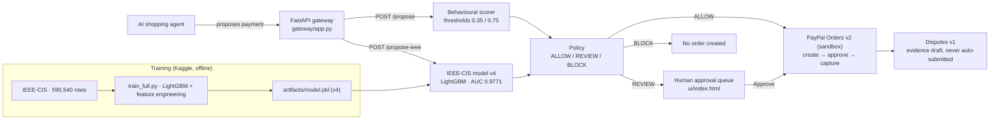

# Gatekeeper — risk-scored payments for AI agents

PayPal AI Hackathon entry (due Nov 12, 2026). Public repo:
https://github.com/faketut/gatekeeper — demo video v2 (2:24, with a live
demo showcase) is at `video/out/gatekeeper-demo-v2.mp4`.

## Thesis

The blocker for agentic commerce is trust: nobody wants an AI agent with a
wallet and no brakes. Gatekeeper sits **between agent intent and payment
execution**. An agent proposes a payment; a risk model scores it; the payment
is auto-approved, routed to a human for approval, or blocked — before any
money moves.

PayPal is load-bearing, not decorative: the demo path is PayPal sandbox
Orders v2 (create / capture / hold), with Disputes v1 simulate endpoints for
the chargeback aftermath. The risk model is trained on IEEE-CIS Fraud
Detection (590K real e-commerce transactions, 3.5% fraud).

## Architecture



| Component | Path | Status |
|---|---|---|
| Risk features + scorer (stdlib, runs anywhere) | `gatekeeper/` | Done, demo-verified |
| Approval policy ALLOW / REVIEW / BLOCK | `gatekeeper/policy.py` | Done; demo thresholds 0.35 / 0.75 |
| Training pipeline (IEEE-CIS, gradient boosting) | `risk/train_ieee.py`, `kaggle-kernel/` | Done — Kaggle v4 full-data run promoted (see "Measured on real IEEE-CIS"); v5 tested, not promoted |
| IEEE model inference | `gatekeeper/ieee_model.py` | Done; v4 thresholds REVIEW 0.0455 / BLOCK 0.5750, chosen on calibration split only |
| PayPal sandbox client (Orders v2) | `gatekeeper/paypal_client.py` | Done (OAuth token caching, create/get/capture); real sandbox order verified CREATED 2026-10-27 (capture needs payer approval via the approve link) |
| Demo video (<3 min) | `video/` | v2 done 2026-11-11 (2:24): S3 is a real screen recording of the live demo page; build sources + final cut in `video/` |
| Disputes v1 client + evidence draft | `gatekeeper/disputes.py` | Implemented (list/show/evidence/accept/escalate/appeal, sandbox-only adjudicate); draft is merchant-review only, never auto-submitted |
| Approval API + execute/capture | `gateway/app.py` | Done, gateway-flow tests pass |
| Approval UI | `ui/index.html` | Done (approve/reject/order/capture) |
| Honest evaluation | `eval/evaluate.py` | Done; training also writes `metrics.json` + `model_card.md` |
| Demo (no credentials, no installs) | `demo/run_demo.py` | 3 scenarios, verified |
| End-to-end demo (mock PayPal) | `demo/e2e_demo.py` | Done with venv deps: propose → ALLOW → order → capture → dispute draft |

## Quickstart — demo, no installs, no credentials

```bash
cd gatekeeper
python3 demo/run_demo.py
python3 -m unittest discover -s tests -v
```

Expected demo output: a normal daytime purchase is ALLOWed, a sudden
$2,000 electronics purchase at 3am from a new device is REVIEWed (human
approval, not auto-blocked), and an extreme $12,000 3am burst from a new
device is BLOCKed.

## Full stack

```bash
python3 -m venv .venv && source .venv/bin/activate
pip install -r requirements.txt
cp .env.example .env   # fill in PayPal SANDBOX credentials only — never production
uvicorn gateway.app:app --reload
# open ui/index.html, or: curl localhost:8000/decisions
```

## Evaluation (the differentiator)

Do not report accuracy on a 3.5%-fraud dataset — it is meaningless there.
Report, at the operating threshold:

- precision / recall / F1 for the fraud class
- precision-recall curve, and the threshold chosen from it
- expected loss: `fraud_loss_avoided - review_cost - false_block_cost`

`eval/evaluate.py` computes all three from a predictions file. The numbers
in `docs/devpost-draft.md` are measured on real IEEE-CIS holdout data
(see below) — no invented metrics.

## Thresholds

Two scorers, two threshold sets — do not conflate them:

- Demo (behavioural) scorer in `gatekeeper/policy.py`: REVIEW at
  p >= 0.35, BLOCK at p >= 0.75. These drive the live demo presets
  ($49 → 5.7% ALLOW, $2,000 → 45.0% REVIEW, $12,000 → 78.8% BLOCK).
- Trained IEEE-CIS model (v4): REVIEW at 0.0455, BLOCK at 0.5750,
  chosen on the calibration split only (review = highest threshold
  with recall >= 0.90; block = highest-recall threshold with
  precision >= 0.90).

## Previously blocked, now unlocked (2026-10-27)

1. **Real IEEE-CIS data.** Kaggle token supplied; the full dataset was
   downloaded via `scripts/download_ieee.py` and trained on Kaggle
   (v4 promoted, see below). No verified public mirror exists; an
   unverified third-party site claiming the file was deliberately not
   used. The pipeline was first proven on synthetic IEEE-schema data
   (20K rows, ROC AUC 0.989 synthetic — that number is synthetic and
   must never be quoted as an IEEE-CIS result).
2. **Real PayPal sandbox.** Sandbox credentials were used transiently
   (never stored in the repo or in memory) to create a real sandbox
   order, verified CREATED with an approve link. Capture needs payer
   approval, per the Orders lifecycle.

## Measured on real IEEE-CIS (2026-10-27, Kaggle v4 run)

Full 590,540 rows (fraud 3.50%, no subsampling), 70/15/15 split,
LightGBM tuned + feature engineering, trained on Kaggle (private
CPU kernel, dataset attached, 450 features: all V1-V339 + identity
left-joined + time/frequency/amount-mean features fitted on train
only). Model selected on calibration AP only, never on test.
Test n=88,581 (3,099 fraud): ROC AUC 0.9771, average precision
0.8711. REVIEW 0.0455: precision 0.4437, recall 0.9051 — only 7.1%
of transactions reviewed. BLOCK 0.5750: precision 0.9287, recall
0.7477. Expected loss per 10K: gated $6,587 vs no-gate $51,593
(review $2, false block $15, fraud loss = amount).
Full provenance, counts, and caveats: `artifacts/model_card-kaggle-v4.md`,
`docs/devpost-draft.md`. The Kaggle v3 model (ROC AUC 0.9647, AP
0.7785, no feature engineering) is superseded; it is kept at
`artifacts/model-v3-kaggle-backup.pkl`. The earlier local 150K run
(ROC AUC 0.9141, AP 0.5874) is also superseded; its model is kept
at `artifacts/model-local-150k-backup.pkl`. A first run with a
13.8% fraud-enriched sample was discarded — do not quote it.
Real sandbox order also verified CREATED (capture needs payer
approval via the approve link).
